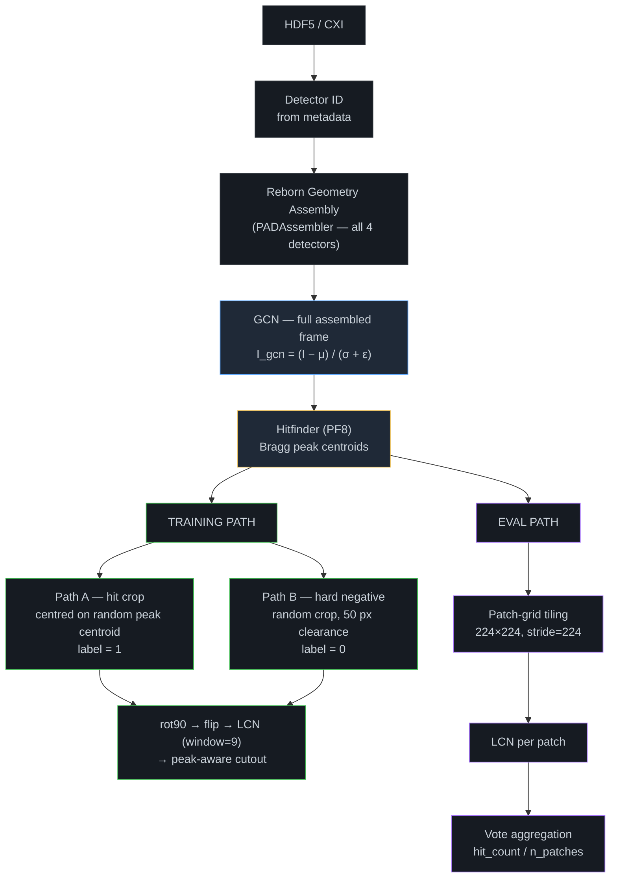
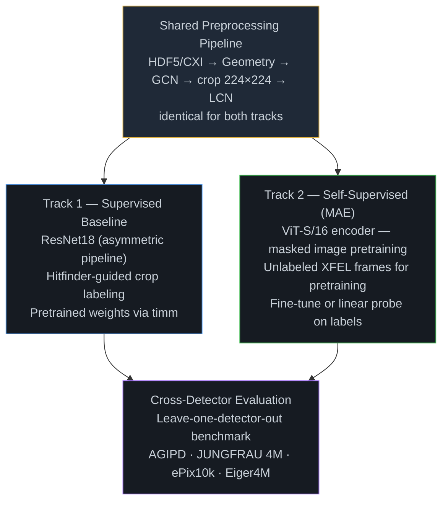

<div align="center">
  
</div>

<div align="center">

[](https://www.python.org/)
[](https://pytorch.org/)
[](https://github.com/gihankaushyal/Hit_finder/actions/workflows/ci.yml)
[](LICENSE)

[](https://biodesign.asu.edu/petra-fromme)

</div>

---

> Every pulse of an X-ray free-electron laser lasts just femtoseconds — yet in that instant, a protein crystal diffracts X-rays into a pattern that can reveal its atomic structure. The problem: fewer than 5% of those pulses actually hit a crystal. Identifying which frames are *hits* — fast, reliably, across instruments at different facilities worldwide — is the first bottleneck in every SFX experiment.

## The Challenge

Current hitfinders are calibrated per-detector. A model trained on AGIPD data at EuXFEL fails silently when deployed on JUNGFRAU data at LCLS. Every facility, every beamtime, requires manual recalibration. This project trains a single ML classifier that **generalizes across four detector types without per-detector retraining** — making hitfinding detector-agnostic. The key: a hitfinder-guided asymmetric crop strategy that assigns labels at the patch level from Bragg spot centroids, not at the frame level.

## The Approach

### Shared Preprocessing Pipeline

All four detector types pass through an **identical, bit-for-bit pipeline** before reaching either model. Detector type is always read from file metadata — never inferred from image content.



> **Key constraint:** GCN is always computed on the full assembled frame before cropping or tiling — never per-patch.

The read → assemble → hitfinder → GCN prefix is deterministic per frame, so it can be cached on disk (**frame cache**, `src/data/frame_cache.py`) and computed once instead of once per epoch. Frames whose file metadata marks them as non-hits skip the hitfinder entirely (**metadata gating**).

### Two-Track Modeling

The shared pipeline feeds two independent model tracks. The supervised vs. self-supervised comparison is itself a scientific contribution of this work.



> **Key constraint:** 224×224 is achieved via crop only — frames are never downsampled. Normalization order: GCN (full frame) → crop → LCN.

## Target Detectors

The model must generalize across all four detectors without per-detector retraining. Post-assembly, all images are normalized and cropped to **224 × 224 × 1** (single channel).

| Detector | Facility | Stored in CXI | Assembled (Reborn) | Module Layout |
|----------|----------|---------------|--------------------|---------------|
| `AGIPD` | EuXFEL | 16 × 512 × 128 px | 1273 × 1273 | 16 modules (128 panels) |
| `JUNGFRAU 4M` | LCLS CXI | 2164 × 2068 px (pre-assembled canvas) | 2173 × 2173 | 8 modules of 514 × 1030 |
| `ePix10k` | LCLS | 5632 × 384 px (stacked panels) | 1667 × 1667 | 64 panels |
| `Eiger4M` | Synchrotron / SSX | 5632 × 384 px (stacked panels) | 1687 × 1687 | 64 panels of 176 × 192 |

All four detectors are assembled with Reborn's `PADAssembler`. Shapes were measured on the production CXI files under `Resonet/production/` and from the geometry loaders in `src/preprocessing/geometry.py`.

## Project Status

| Phase | Description | Status |
|-------|-------------|--------|
| 1 | Proposal & methodology finalization | ✅ Complete |
| 2 | Data infrastructure (real + synthetic) | ✅ Complete |
| 3 | Preprocessing implementation | ✅ Complete |
| 4 | Supervised baseline (ResNet18 → ResNet50) | ✅ Complete |
| **5** | **SSL model (MAE pretraining → fine-tune)** | 🔄 **IN PROGRESS** |
| 6 | Ablations & cross-detector benchmarking | ⏳ Pending |
| 7 | Deployment preparation | 🔮 Future |
| 8 | Thesis writing | 🔮 Future |

## Results — Supervised Learning Baseline (LODO, 4-fold)

Leave-one-detector-out (LODO) cross-detector generalization benchmark. Each fold holds out one detector type entirely from training and evaluates on it at test time. Metrics are computed at the frame level via patch-grid vote aggregation.

### Phase 4 Naive Baseline — frame-level labels, random crops

| Fold | Held-out | Cross AP | Cross AUC | Cross F1 |
|------|----------|----------|-----------|----------|
| 1 | AGIPD | 0.5649 | 0.5904 | 0.6661 |
| 2 | JUNGFRAU 4M | 0.8683 | 0.8156 | 0.7816 |
| 3 | ePix10k | 0.8825 | 0.8886 | 0.8092 |
| 4 | Eiger4M | 0.9310 | 0.9138 | 0.8189 |
| **Mean** | | **0.812 ± 0.167** | | |

The naive pipeline assigned frame-level hit/non-hit labels to all random 224×224 crops — including background crops from hit frames — producing ambiguous training signal. AGIPD cross AP of 0.565 reflects near-random generalization.

### Asymmetric Pipeline Baseline — hitfinder-guided crops + masked LCN

Hitfinder-guided cropping (Path A: centroid-centred, label=1 / Path B: hard-negative, label=0), variance-form masked LCN, and peak-aware cutout replace the naive strategy.

| Fold | Held-out | Cross AP | Cross AUC | Cross F1 | Δ AP |
|------|----------|----------|-----------|----------|------|
| 1 | AGIPD | 0.8074 | 0.8652 | 0.8108 | **+0.242** |
| 2 | JUNGFRAU 4M | 0.8584 | 0.9639 | 0.7570 | −0.010 |
| 3 | ePix10k | 0.8585 | 0.9106 | 0.8943 | −0.024 |
| 4 | Eiger4M | 0.8330 | 0.8596 | 0.8138 | −0.098 |
| **Mean** | | **0.839 ± 0.024** | | | **+0.027** |

- **AGIPD generalization gap largely closed:** 0.565 → 0.807 (+0.242). Hitfinder-guided crops eliminated the spurious panel-edge signal the model previously relied on.
- **Variance collapsed ~7×:** ±0.167 → ±0.024 — the pipeline is now consistently effective across all four detector types.
- All "±" values in this README are the sample standard deviation (n−1) over the four folds, as reported by `scripts/aggregate_lodo_results.py`.
- **AP is the primary metric.** Cross F1 is the F1 at the best threshold on the held-out detector itself, so it is a best-case operating point; AP and AUC need no threshold. See [docs/eval_protocol.md](docs/eval_protocol.md).
- Full per-fold in-domain breakdown → [docs/detailed_notes.md](docs/detailed_notes.md)

### Asymmetric Pipeline v2 — frame-cache-backed training

Same preprocessing as the baseline above, now backed by the on-disk frame cache (matches the uncached path through GCN: masks and centroids exactly, frames up to float16 storage rounding, per the cache's equivalence test) — the gain below comes from cheaper epochs under the same early-stopping budget, not a preprocessing change.

| Fold | Held-out | Cross AP | Cross AUC | Cross F1 | Δ AP vs. v1 |
|------|----------|----------|-----------|----------|------|
| 1 | AGIPD | 0.7897 | 0.8473 | 0.7281 | −0.018 |
| 2 | JUNGFRAU 4M | 0.8727 | 1.0000 | 0.7724 | +0.014 |
| 3 | ePix10k | 0.9393 | 1.0000 | 0.8994 | +0.081 |
| 4 | Eiger4M | 0.9980 | 0.9998 | 0.9921 | +0.165 |
| **Mean** | | **0.900 ± 0.090** | | | **+0.061** |

- **Mean cross AP improved to 0.900 ± 0.090**, but with higher fold-to-fold variance than v1 (±0.021 → ±0.090) — AGIPD is the only fold that regressed, while ePix10k and Eiger4M improved substantially.
- Full details and discussion → [docs/progress_notes.md §21](docs/progress_notes.md)

## Results — Track 2 Self-Supervised (MAE, ViT-S/16)

MAE pretraining (400 epochs) on pooled unlabeled frames, then either full fine-tuning or a frozen-encoder linear probe on the labeled LODO folds. Same LODO protocol and frame-level vote aggregation as Track 1.

| Variant | Mean cross AP | Std | Folds |
|---------|---------------|-----|-------|
| ResNet18 asymmetric, v1 (Track 1) | 0.839 | 0.024 | 4/4 |
| ViT-S/16 MAE fine-tune (Track 2) | 0.836 | 0.058 | 4/4 |
| ViT-S/16 MAE linear probe (Track 2) | 0.829 | 0.084 | 3/4 — fold 2 (JUNGFRAU 4M) probe cancelled at epoch 79 |

| Fold | Held-out | Fine-tune AP | Linear-probe AP |
|------|----------|--------------|-----------------|
| 1 | AGIPD | 0.7519 | 0.8415 |
| 2 | JUNGFRAU 4M | 0.8754 | cancelled |
| 3 | ePix10k | 0.8747 | 0.9062 |
| 4 | Eiger4M | 0.8402 | 0.7397 |

- **Caveat — mixed encoder generations:** the fold 1 and 2 MAE encoders were written on 2026-09-07, before the crop-diversity fix (PR #34, merged 2026-09-08); the fold 3 and 4 encoders (2026-09-10) include it. Fold 1 (AGIPD) is also the weakest fine-tune fold, so that gap may partly reflect the older encoder (n = 2, not proven).
- **Comparable to Track 1 v1, with higher variance:** the fine-tuned ViT-S matches the supervised ResNet18 on mean cross AP (0.836 vs 0.839) but is less consistent across held-out detectors.
- **Not yet compared against Track 1 v2 (0.900):** these SSL numbers come from the September 2026 generation (pretrain checkpoints `mae-vits16-fold*`), run on uncached preprocessing like Track 1 v1, so that pair is like-for-like. The SSL rerun under the current run-naming standard (`mae-vits16-v2`, `vits16-mae-finetune-v2`, `vits16-mae-probe-v2`) is still in progress (1 of 4 folds finished), so a like-for-like comparison with v2 is pending.
- Per-fold detail and the comparison discussion → [docs/progress_notes.md §15.7](docs/progress_notes.md)

## Setup

**Compute:** ASU Sol HPC — dedicated H100 (scg020) + A100 pool · SLURM scheduler

```bash
# Create environment (first time)
mamba env create -f environment.yml -n sfx-hitfinder

# Activate (always in this order on Sol)
module load mamba/latest
source activate sfx-hitfinder

# Verify imports
python -c "import torch, h5py, reborn, timm, fabio; print('imports OK')"

# Verify CUDA on a compute node
srun --partition=<your-partition> --gpus=1 --pty bash
python -c "import torch; print(torch.cuda.is_available(), torch.version.cuda)"
```

**Supported image formats:** `.h5` / `.cxi` (HDF5, multi-panel detectors via Reborn) and `.img` (ADSC/MAR, pre-assembled, read via fabio).

```bash
# Run tests (699 tests; CI runs black --check, then pytest)
pytest tests/ -v

# Check formatting before committing
black src/ tests/
```

**Training** (load the W&B key first with `source .secrets/wandb.env`; never paste it on a command line):

```bash
# Track 1 — asymmetric pipeline. --run-name-prefix is required (see src/training/run_naming.py);
# an existing checkpoint under the resolved name needs --resume-training or --override-training.
python -m src.training.train_asymmetric --config configs/supervised/resnet18_asymmetric.yaml \
    --run-name-prefix resnet18-asymmetric-v2 --folds 2

# Track 2 — MAE pretrain, then fine-tune
python -u -m src.training.train_ssl_pretrain --config configs/ssl/mae_pretrain.yaml --fold 1 --run-name-prefix mae-vits16-v2
python -u -m src.training.train_ssl_finetune --config configs/ssl/mae_finetune.yaml --fold 1 \
    --run-name-prefix vits16-mae-v2 --pretrain-checkpoint checkpoints/mae-vits16-v2-fold1-seed42/last.pt

# Re-evaluate a finished run without training (needs best.pt)
python -m src.training.train_asymmetric --config configs/supervised/resnet18_asymmetric.yaml \
    --run-name-prefix resnet18-asymmetric-v2 --folds 2 --inference-only

# Summarize finished folds
python scripts/aggregate_lodo_results.py
```

**Frame cache** (optional, enabled by the `cache:` block in a run config): caches the read → assemble → hitfinder → GCN prefix so it runs once per frame rather than once per epoch.

```bash
python -m scripts.build_frame_cache --config configs/ssl/mae_pretrain.yaml --cache-root <path>
bash scripts/stage_frame_cache.sh <fold-plan>   # rsync a fold's entries to local NVMe
```

SLURM submit scripts live in `scripts/` (start from `scripts/templates/slurm_gpu_job.sh`). A local repository dashboard (TypeScript, Hono API + React/Vite) is described in [dashboard/README.md](dashboard/README.md).

## Documentation

| Document | Contents |
|----------|----------|
| [Detailed Notes](docs/detailed_notes.md) | Per-fold LODO results with in-domain breakdown (Track 1 v1/v2, Track 2), pipeline decisions |
| [Progress Notes](docs/progress_notes.md) | Chronological project log: experiments, bugs, and decisions per phase |
| [Architecture](docs/architecture.md) | Codebase structure and component design |
| [Codebase Reference](docs/codebase/index.md) | Module map, data flow, extension guide, testing |
| [Evaluation Protocol](docs/eval_protocol.md) | LODO benchmark design, metrics, result files |
| [Data Spec](docs/data_spec.md) | HDF5 key reference and shapes per detector type |
| [Dashboard](dashboard/README.md) | Local repository dashboard (runs, kanban, agents) |

## Citation

If you use this work, please cite:

```bibtex
@misc{ketawala2026sfxhitfinder,
  author      = {Ketawala, Gihan},
  title       = {Detector-Agnostic Hitfinder for Serial Femtosecond X-ray Crystallography},
  year        = {2026},
  note        = {Arizona State University, Fromme Lab},
  url         = {https://github.com/gihankaushyal/Hit_finder}
}
```

## Acknowledgments

Developed at the [Fromme Lab](https://biodesign.asu.edu/petra-fromme), Biodesign Institute, Arizona State University, under the supervision of Prof. Petra Fromme. Compute resources provided by the ASU Sol HPC cluster.
