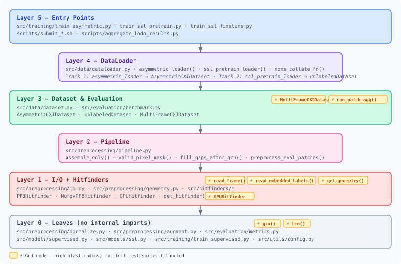

# Codebase Reference

> Read this page before modifying any module. Use the sub-pages to navigate to what you need.

This reference covers the Hit_finder SFX hit-classification system — a deep learning pipeline that reads raw detector frames from CXI files and outputs per-frame hit/no-hit predictions.

---

## Two-Track Architecture

The project runs two parallel modeling strategies that share the same preprocessing pipeline:

**Track 1 — Supervised** trains a ResNet18/50 directly on labeled CXI frames. A hitfinder (PF8 or GPU) locates Bragg peaks on each frame; crops centered on those peaks become positive training examples, while crops placed ≥50 px from all peaks become negatives. The hitfinder only runs on frames whose embedded label is HIT (metadata gating). The labels come from the CXI files themselves (`entry_1/labels/hit`).

**Track 2 — Self-Supervised (MAE)** pretrains a ViT-S/16 encoder on a large pool of *unlabeled* diffraction frames using masked autoencoders (MAE): 60% of the 16×16 patches of each 224×224 crop are masked out (`ssl.mask_ratio`) and the model learns to reconstruct them from context. A classification head is then fine-tuned (or, with `--linear-probe`, trained on a frozen encoder) on the same labeled CXI data as Track 1.

Both tracks run the **identical preprocessing pipeline** — read → assemble (Reborn) → hitfinder (metadata-gated) → GCN on the full assembled frame → 224×224 crop/tile → `random_rot90` → `random_flip` → masked LCN → peak-aware cutout (training only; Track 2 uses MAE masking instead of cutout) — so any preprocessing change affects both. The read → GCN prefix can be served from an on-disk **frame cache** (`src/data/frame_cache.py`). The comparison between Track 1 and Track 2 is itself a scientific contribution of this project.

---

## Module Dependency Graph

Auto-generated from the live codebase. Thicker clusters are tighter communities; ⚡ badges mark the most-connected functions (highest blast radius):

> **For function-level exploration with pan/zoom/search** — open `graphify-out/graph.html` (generated locally by `graphify update .`, not tracked in git) in a browser (3326 nodes, 6756 edges, 240 communities as of 2026-10-29; the graph also covers `dashboard/` and `tests/`, so counts are larger than for `src/` alone). The static image above is a curated older snapshot.

---

## Navigation

| Page | Use this when… |
|------|---------------|
| [Module Reference](modules.md) | "I need to modify X — what imports it and what does it import?" |
| [Data Flow Walkthrough](data-flow.md) | "Walk me through what happens to a frame from disk to prediction" |
| [Extension Guide](extension-guide.md) | "Where do I add a new detector / hitfinder backend / model / metric?" |
| [Testing Guide](testing.md) | "How do I run the tests? Where do I add a new test?" |

Run naming, the resume/override gate, W&B run identity and the frame cache are covered in [Module Reference → `src/training/`](modules.md#srctraining) and [`src/data/`](modules.md#srcdata), and in the [Extension Guide](extension-guide.md) (run-naming, override and inference-only sections). The system-level view is in [../architecture.md](../architecture.md).

---

## God Nodes (most-connected — highest blast radius)

If you touch these, run the full test suite. Edge counts are from the graph rebuilt on 2026-10-29 (`graphify-out/GRAPH_REPORT.md`) and include test and script usages. The table lists `src/` symbols only; the whole-graph top 10 also contains `_make_run_dir()` (a test helper in `tests/test_run_naming.py`, 38 edges) and the dashboard's `EventBus` (33), `Config` (31) and `useResource()` (30).

| Symbol | File | Edges |
|--------|------|-------|
| `FrameCache` | `src/data/frame_cache.py` | 46 |
| `AsymmetricCXIDataset` | `src/data/dataset.py` | 41 |
| `check_checkpoint_collisions()` | `src/training/run_naming.py` | 40 |
| `load_config()` | `src/utils/config.py` | 40 |
| `MockHitfinder` | `src/hitfinders/base.py` | 36 |
| `run_patch_agg()` | `src/evaluation/benchmark.py` | 31 |
| `get_hitfinder()` | `src/hitfinders/__init__.py` | 27 |
| `lcn()` | `src/preprocessing/normalize.py` | 26 |
| `get_geometry()` | `src/preprocessing/geometry.py` | 24 |
| `read_frame()` | `src/preprocessing/io.py` | 22 |
| `MultiFrameCXIDataset` (deprecated) | `src/data/dataset.py` | 22 |
| `gcn()` | `src/preprocessing/normalize.py` | 20 |
| `read_embedded_labels()` | `src/preprocessing/io.py` | 19 |

(`GPUHitfinder` is in `src/hitfinders/gpu.py`, 18 edges.)
